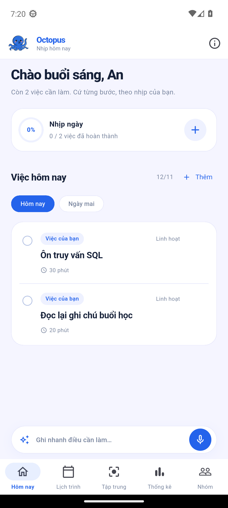
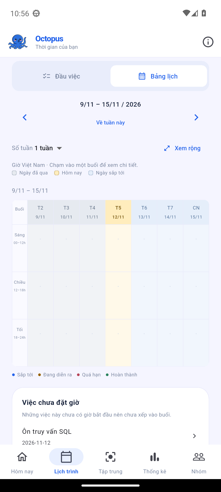
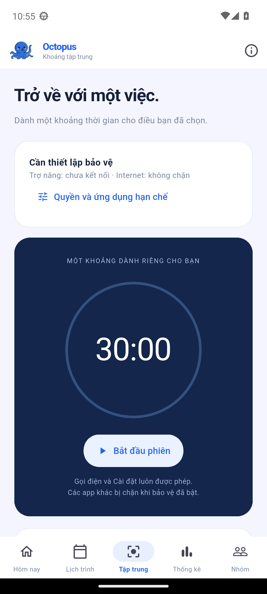

<p align="center">
  
</p>

<h1 align="center">Octopus</h1>

<p align="center">Ứng dụng Android giúp lên lịch học, hạn chế xao nhãng và theo dõi những việc đã làm.</p>

<p align="center"><strong>Android 0.6.8</strong> · Bản thử nghiệm · AI in Economics 2026</p>

<p align="center">
  <a href="docs/user-guide.md">Hướng dẫn sử dụng</a>
  · <a href="#chạy-thử">Chạy thử</a>
  · <a href="docs/architecture.md">Kiến trúc</a>
  · <a href="docs/">Tài liệu dự án</a>
</p>

Octopus do đội Octopus phát triển để dự thi AI in Economics 2026.

## Giao diện Android

<p align="center">
  
  
  
</p>

Ảnh chụp Octopus 0.6.3 trên Android Emulator với dữ liệu minh họa.

## Tính năng

| Tính năng | Cách sử dụng |
| --- | --- |
| Công việc và check-out | Thêm việc hôm nay hoặc ngày mai, ước lượng thời lượng, đánh dấu hoàn thành và ghi kết quả. Có thể ghi hoạt động ngoài điện thoại kèm ảnh. |
| Lịch trình | Đặt lịch cố định theo ngày trong tuần, xem lịch 1, 2 hoặc 4 tuần và mở chi tiết từng buổi. |
| Lập lịch AI Starter | Nhập mục tiêu ôn tập để nhận đề xuất theo lịch cố định và quỹ học. Xem trước rồi xác nhận các buổi muốn lưu. Có 5 lượt lập lịch mỗi tháng cho mỗi bản cài hoặc trình duyệt. |
| Tập trung và nhắc nghỉ | Dùng bộ đếm và tùy chọn hạn chế ứng dụng hoặc Internet sau khi cấp quyền Android. Phiên dài có thể nhắc nghỉ và uống nước. |
| Thống kê và widget | Xem thời gian sử dụng theo ứng dụng. Dùng widget Ghi nhanh và Nhịp hôm nay để mở việc, xem tiến độ hoặc bắt đầu tập trung. |
| Vòng tròn cam kết | Ghi cam kết, check-in và xem chuỗi trên thiết bị. |

## Chạy thử

**Bản source nộp AE:** bắt đầu tại [SUBMISSION.md](SUBMISSION.md), kể cả khi giải nén ZIP và không cài Git. Xem [kê khai thư viện và AI API](THIRD_PARTY_NOTICES.md), [phiên bản phụ thuộc](docs/dependencies.json) và [giấy phép bên thứ ba](LICENSES/).

**Chạy thử cho ban giám khảo.** [Website công khai](https://zomboxx.github.io/Octopus/) · [Tải APK](https://github.com/zomboXx/Octopus/releases/tag/v0.6.8-ae.2) · [Docker Compose và Android Emulator](docs/demo-setup.md)

**Web cục bộ.** Cần Node.js 22 trở lên. Chạy từ thư mục gốc của repo, sau đó mở [trang giới thiệu](http://127.0.0.1:4174/) hoặc [bản trải nghiệm](http://127.0.0.1:4174/try/). Chọn **Dùng hồ sơ mẫu An** để thử các luồng chính.

```sh
cd apps/website
npm ci
npm start
```

**Android.** Cần Flutter SDK hỗ trợ Dart 3.11.5 và Android SDK. Mở emulator hoặc kết nối thiết bị, rồi chạy từ thư mục gốc.

```sh
cd apps/mobile
flutter pub get
flutter run --dart-define=OCTOPUS_API_URL=https://octopus-planning.beadedeasel2.chatgpt.site
```

Trên Windows, chạy `./scripts/build-preview-apk.ps1` trong `apps/mobile` để tạo APK debug. File nằm tại `apps/mobile/artifacts/octopus-android-debug.apk` tính từ gốc repo. [Quy trình Android và kiểm thử](docs/testing.md)

**Lập lịch AI.** Web công khai và APK phát hành sử dụng Starter. Web cũng có lịch mẫu. [Cấu hình AI](docs/ai-beta.md)

## Cấu trúc repo

| Thư mục | Nội dung |
| --- | --- |
| [`apps/mobile/`](apps/mobile/) | Flutter, Kotlin, tài nguyên Android, widget và kiểm thử. |
| [`apps/website/`](apps/website/) | Trang giới thiệu, demo trình duyệt, hàm Vercel và bộ lập lịch dùng chung. |
| [`apps/api/`](apps/api/) | API cho web và Android, máy chủ phát triển và kiểm thử. |
| [`docs/`](docs/) | Hướng dẫn sử dụng, kiến trúc, kiểm thử, cấu hình AI và triển khai. |

## Trạng thái

Android 0.6.8 đã chạy trên Android Emulator. Công việc, hồ sơ khách và vòng tròn cam kết được lưu cục bộ. GitHub Pages hỗ trợ cả lịch mẫu và lập lịch AI Starter. [Cấu hình triển khai](docs/deployment.md)
